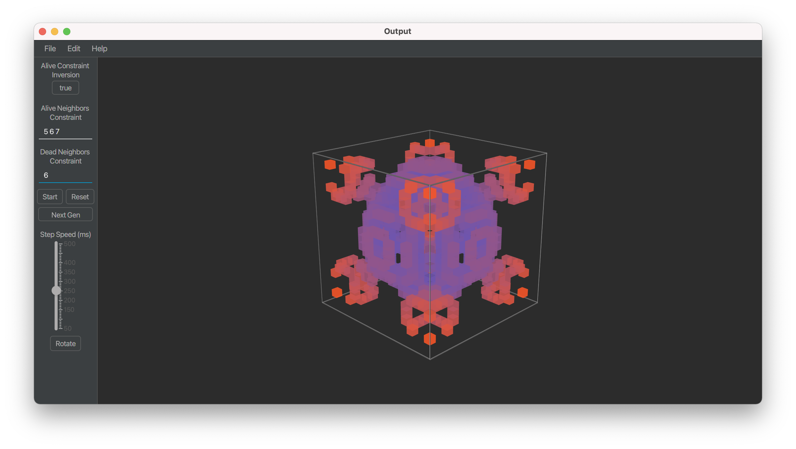
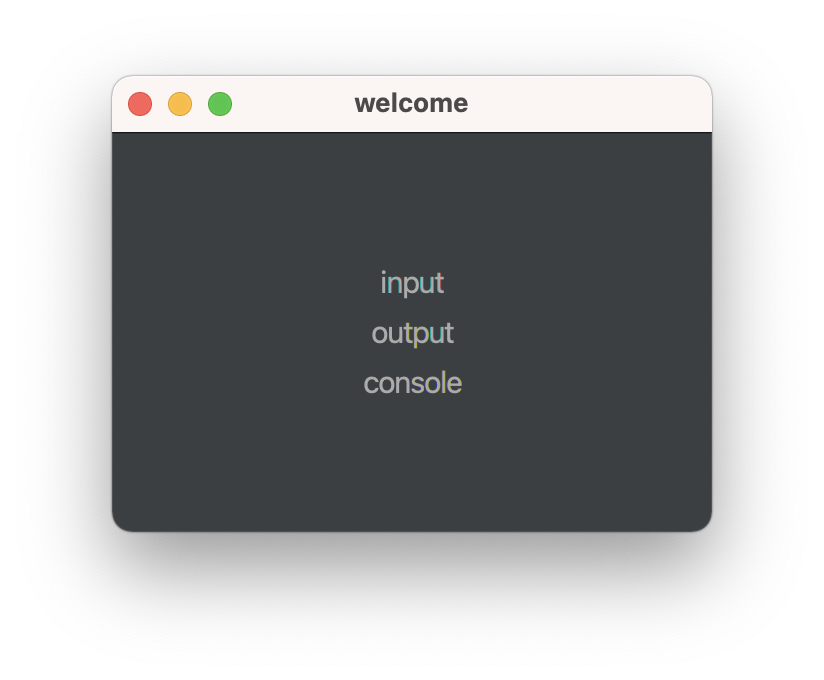
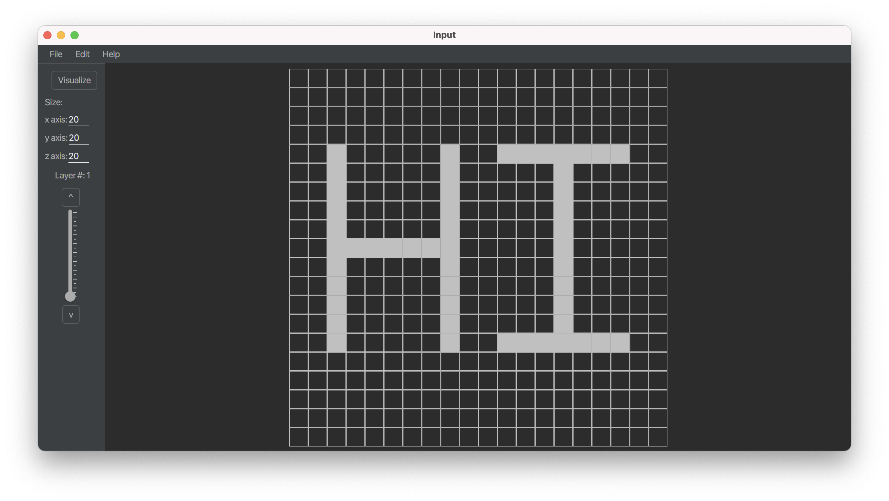
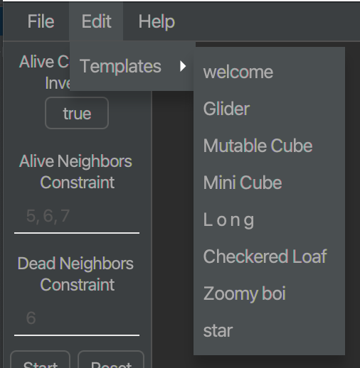
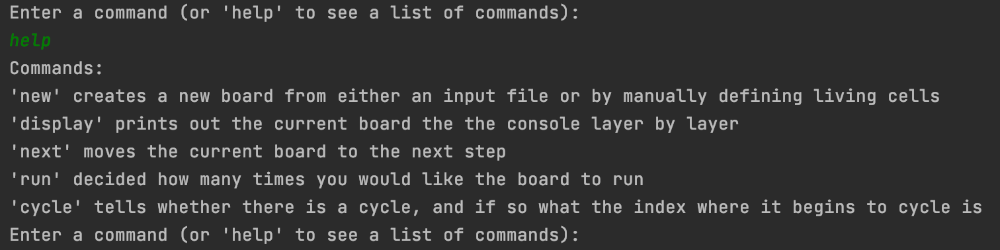

# Game of Life 3D

Inspired by [Conway's Game of Life](https://en.wikipedia.org/wiki/Conway%27s_Game_of_Life), this program lets you create, run, and explore three-dimensional cellular automata. Build a pattern layer by layer, choose its rules, and watch it change over time.



*The 3D view, with controls for rules, generation speed, rotation, and reset.*

## Motivation

The rules of a cellular automaton are simple, but the patterns they produce can be difficult to picture, especially in three dimensions. We wanted a way to experiment with those rules and see the results directly.

We added the layer editor after realizing how difficult it was to create a useful starting pattern without a dedicated GUI. The editor and 3D view let us move between designing a pattern and exploring what happens to it.

## Using the program

The welcome screen has three options:



- **Input:** create or edit a starting template.
- **Output:** open a template and visualize it in 3D.
- **Console:** create a board and view its generations as text in the terminal.

For a quick look, choose **Output**, open a built-in template, and use **Next Generation** to step through its changes. Use **Start** to run it continuously, **Rotate** to see it from different angles, and **Reset** to return to the initial generation.

## Input: building a template



The input view lets you paint and erase cells one layer at a time. Choose the board dimensions, move between layers, and build the starting pattern before opening it in the output view.

The editor includes:

- Custom board dimensions and layer controls
- Painting, erasing, and filling or clearing a layer
- Center axes to help align a pattern
- **Edit → Clear all layers** to start again
- **File → Save Template** and **File → Open Template** for reusing designs

### Keybinds

| Action | Keybind |
| --- | --- |
| Move up a layer | `W` |
| Move down a layer | `S` |
| Fill the current layer | `Ctrl + F` |
| Clear the current layer | `Ctrl + C` |
| Paint cells | `Alt` + mouse hover |
| Erase cells | `Ctrl` + mouse hover |

## Output: exploring a pattern

The output view accepts a user-created template, a built-in template, or a saved file. Once a board is loaded, you can:

- Change the alive and dead neighbor rules
- Run the simulation or advance one generation at a time
- Adjust the time between generations
- Rotate the model while it is running or paused
- Reset to the original state
- Open another template or save a generation from the **File** menu

### Templates



Built-in templates provide a starting point for experimenting. Some have their own rule settings. Watch these examples:

- [Welcome](https://imgur.com/a/8Ueq9px)
- [Star](https://imgur.com/a/cexPAoS)
- [Checkered Loaf](https://imgur.com/a/sz0bwvQ)
- [Mini Cube](https://imgur.com/a/dWu7Pdy)

The template files are also available in [src/templates](src/templates).

## Console



The console offers a text-based way to create and step through a board. Choose **console** from the welcome menu and follow the prompts in the terminal that launched the application.

## Digging deeper

### Alive/dead neighbor rules

In Conway's two-dimensional Game of Life, a cell has eight neighbors. A live cell survives with two or three live neighbors, and a dead cell becomes alive with three.

In this project, the [Moore neighborhood](https://en.wikipedia.org/wiki/Moore_neighborhood) extends into three dimensions. Each cell has 26 neighbors: the cells around it in its own layer and in the layers above and below.

The default rules are:

- A live cell with **five, six, or seven** live neighbors survives.
- A dead cell with **six** live neighbors becomes alive.
- All other live cells die; all other dead cells stay dead.

Both sets of neighbor counts can be changed in the output view. Changing a rule can produce very different behavior from the same starting pattern.

### The `trueFirst` constraint

The application also has an **Alive Constraint Inversion** option, called `trueFirst` in the code. It changes how the live-cell rule is interpreted.

With `trueFirst` set to `true`, live cells survive when their neighbor count matches the alive constraint. With it set to `false`, matching live cells die and nonmatching live cells survive. The dead-cell birth rule stays the same.

### How it is organized

The project is written in Java with JavaFX for the editor, controls, and 3D display. [Board.java](src/controllers/Board.java) calculates each generation from a separate copy of the previous one, so updating a cell does not affect the other cells in that step.

The [input controller](src/controllers/inputController.java), [output controller](src/controllers/outputController.java), and [file handling](src/controllers/fileIO.java) connect that board logic to the interface and saved templates.

## Running locally

Use JDK 16 and the [JavaFX 16 SDK](https://gluonhq.com/products/javafx/) for your operating system and CPU architecture. Open the project in IntelliJ or Eclipse.

1. Clone the repository and open it in your IDE:

   ```sh
   git clone https://github.com/freycp20/3dGameOfLifeGit.git
   cd 3dGameOfLifeGit
   ```

2. Select your JDK and mark `src` as a source folder.
3. Add the JARs from your JavaFX SDK's `lib` folder to the project libraries. Replace any old JavaFX library paths in the imported IDE settings with your local SDK path.
4. In the run configuration for `main`, add these VM options, replacing the example path:

   ```text
   --module-path "/path/to/javafx-sdk/lib" --add-modules javafx.controls,javafx.fxml
   ```

5. Keep `src/resources` available on the runtime classpath as `/resources`, and set the working directory to the repository root. Built-in templates are loaded from `src/templates` relative to that directory.
6. Run [src/main.java](src/main.java). It opens the welcome screen shown above.

Setup videos are available for [IntelliJ](https://www.youtube.com/watch?v=BHj6zbH3inI) and [Eclipse](https://www.youtube.com/watch?v=bC4XB6JAaoU).

## Project team

Created by Caleb Frey, Keegan Woodburn, and Michael Gomez.
